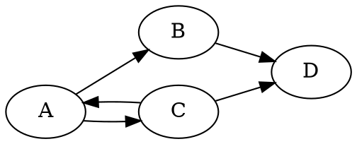

# Визуализатор графа зависимостей

Практическая работа №2 по дисциплине  
«Конфигурационное управление».

Вариант №7.

Реализованы все пять этапов работы:

- Этап 1 — конфигурация приложения;
- Этап 2 — получение прямых зависимостей;
- Этап 3 — построение графа зависимостей с помощью рекурсивного DFS;
- Этап 4 — определение порядка загрузки зависимостей;
- Этап 5 — визуализация графа с помощью Graphviz, PNG и ASCII-дерева.

## Описание

Программа представляет собой CLI-приложение для анализа и визуализации
направленного графа зависимостей JavaScript-пакетов формата npm.

При работе с реальным репозиторием программа не использует менеджер
пакетов npm или сторонние библиотеки для получения списка зависимостей.

Для каждого анализируемого пакета программа:

1. получает метаданные из npm Registry;
2. определяет latest-версию;
3. получает ссылку `dist.tarball`;
4. самостоятельно скачивает `.tgz`-архив;
5. открывает архив;
6. извлекает `package/package.json`;
7. самостоятельно читает поле `dependencies`;
8. рекурсивно повторяет анализ зависимостей до заданной глубины;
9. строит направленный граф зависимостей;
10. формирует текстовое представление Graphviz;
11. сохраняет изображение графа в PNG;
12. при наличии флага `--ascii-tree` выводит зависимости в виде
    ASCII-дерева.

GitHub для получения пакетов и информации о зависимостях не
используется.

Готовые средства получения списка зависимостей внутри программы также
не используются.

## Параметры командной строки

Программа поддерживает следующие параметры:

- `--package` — имя анализируемого пакета;
- `--repository` — URL npm Registry или путь к тестовому репозиторию;
- `--test-mode` — режим работы с локальным тестовым репозиторием;
- `--output` — имя PNG-файла с изображением графа;
- `--ascii-tree` — вывод зависимостей в виде ASCII-дерева;
- `--max-depth` — максимальная глубина анализа зависимостей.

Обязательные параметры:

- `--package`;
- `--repository`;
- `--output`;
- `--max-depth`.

`--test-mode` и `--ascii-tree` являются флагами.

Пример:

```powershell
python src\main.py --package express --repository https://registry.npmjs.org --output express.png --max-depth 2
```

## Этап 1 — конфигурация

На первом этапе реализованы:

- CLI-интерфейс;
- получение параметров командной строки;
- проверка пользовательских параметров;
- проверка URL;
- проверка максимальной глубины;
- проверка имени выходного файла;
- проверка пути тестового репозитория;
- обработка ошибок.

На первом этапе пользовательские параметры выводились в формате:

```text
ключ: значение
```

## Этап 2 — получение прямых зависимостей

На втором этапе реализовано самостоятельное получение прямых
зависимостей npm-пакета.

Менеджер пакетов npm для получения зависимостей внутри программы
не используется.

Алгоритм:

```text
npm Registry
    ↓
метаданные пакета
    ↓
dist-tags.latest
    ↓
versions[latest].dist.tarball
    ↓
скачивание .tgz
    ↓
открытие архива
    ↓
package/package.json
    ↓
dependencies
```

Для получения зависимостей используются средства стандартной библиотеки
Python.

### Получение архива

Из метаданных пакета определяется latest-версия.

После этого из:

```text
versions[latest].dist.tarball
```

получается URL `.tgz`-архива.

Архив самостоятельно скачивается через `urllib.request`.

### Чтение package.json

Скачанный архив открывается модулем:

```text
tarfile
```

Для работы с архивом в памяти используется:

```text
io.BytesIO
```

Из архива извлекается:

```text
package/package.json
```

После разбора JSON прямые зависимости самостоятельно берутся из поля:

```text
dependencies
```

## Этап 3 — построение графа зависимостей

На третьем этапе реализовано построение направленного графа зависимостей
с учётом транзитивности.

Граф строится алгоритмом **DFS с рекурсией**.

Если пакет `A` зависит от пакета `B`, в графе создаётся направленное
ребро:

```text
A → B
```

Для каждого пакета программа получает его непосредственные зависимости,
после чего рекурсивно анализирует каждую из них.

Пример:

```text
A
├── B
│   └── D
└── C
    └── E
```

`B` и `C` являются прямыми зависимостями `A`, а `D` и `E` —
транзитивными зависимостями.

### Максимальная глубина

Параметр:

```text
--max-depth
```

ограничивает глубину рекурсивного анализа.

Начальный пакет имеет глубину `0`.

Его прямые зависимости находятся на глубине `1`.

При:

```text
--max-depth 1
```

получаются прямые зависимости начального пакета, но их собственные
зависимости уже не раскрываются.

При:

```text
--max-depth 2
```

анализируется ещё один уровень транзитивных зависимостей.

## Обработка циклических зависимостей

Программа корректно предотвращает бесконечный рекурсивный обход
циклических зависимостей.

Например:

```text
A → B
B → C
C → A
```

не приводит к бесконечной рекурсии.

Во время DFS сохраняется информация об уже посещённых пакетах и глубине
их посещения.

Если пакет уже был обработан на такой же или меньшей глубине,
повторный рекурсивный обход не выполняется.

## Тестовый режим

Для проверки алгоритмов без обращения к реальному npm Registry
поддерживается:

```text
--test-mode
```

В тестовом режиме вместо URL репозитория пользователь указывает путь
к локальному JSON-файлу.

Имена тестовых пакетов должны состоять из заглавных латинских букв.

Пример `test_repository.json`:

```json
{
    "A": ["B", "C"],
    "B": ["D"],
    "C": ["A", "D"],
    "D": []
}
```

В данном примере присутствуют:

- прямые зависимости;
- транзитивные зависимости;
- пакет без зависимостей;
- цикл `A → C → A`.

Все зависимости, указанные в тестовом репозитории, должны также иметь
собственное описание в этом файле.

Пример запуска:

```powershell
python src\main.py --package A --repository test_repository.json --test-mode --output graph.png --max-depth 3 --ascii-tree
```

## Этап 4 — порядок загрузки зависимостей

На четвёртом этапе был реализован режим вывода порядка загрузки
зависимостей для заданного пакета.

После построения графа выполняется дополнительный рекурсивный DFS.

Пакет добавляется в порядок только после обработки доступных ему
зависимостей.

Например:

```text
A → B
A → C
B → D
C → D
```

даёт:

```text
D -> B -> C -> A
```

Для предотвращения повторной обработки используется множество
посещённых вершин.

Зависимости перебираются в отсортированном порядке, поэтому результат
является детерминированным.

Функции Этапа 4 сохранены в программе, однако в Этапе 5 основной вывод
CLI посвящён визуализации графа.

## Сравнение порядка загрузки с npm

Для проверки Этапа 4 результат сравнивался с настоящим менеджером
пакетов npm.

Сравнение выполнялось отдельно от основной программы.

Использовался пакет:

```text
express@5.3.0
```

Команды:

```powershell
npm init -y
npm install express@5.3.0
npm ls --all --depth=2
```

`npm ls` показал логическое дерево реально установленных зависимостей.

В дереве присутствовали, например:

```text
express@5.3.0
├── accepts@2.0.0
├── body-parser@2.4.0
├── content-disposition@2.0.1
├── content-type@2.1.0
├── cookie-signature@1.2.2
├── cookie@0.7.2
└── debug@4.4.3
```

Для некоторых пакетов npm показывал:

```text
deduped
```

npm разрешает диапазоны версий и выполняет дедупликацию, поэтому его
результат может отличаться от результата программы.

Текущая программа при анализе каждого транзитивного npm-пакета получает
его latest-версию.

## Этап 5 — визуализация

На пятом этапе реализована визуализация построенного направленного графа
зависимостей.

Этап включает:

- формирование текстового представления Graphviz;
- сохранение графа в PNG;
- вывод ASCII-дерева при наличии флага;
- демонстрацию на трёх различных пакетах;
- сравнение результата со штатным инструментом npm.

## Graphviz-представление

После построения граф преобразуется в язык DOT, используемый Graphviz.

Например, для тестового репозитория:

```text
A → B
A → C
B → D
C → A
C → D
```

формируется:



Таким образом, направление зависимости сохраняется и в визуальном
представлении.

Если пакет `A` зависит от `B`, Graphviz получает:

```dot
"A" -> "B";
```

## Сохранение PNG

Для преобразования DOT-представления в изображение используется
программа Graphviz `dot`.

Программа запускает:

```text
dot -Tpng
```

через модуль Python:

```text
subprocess
```

Graphviz получает уже построенный программой граф и используется
**только для визуализации**.

Graphviz не используется для получения списка зависимостей.

Имя итогового PNG передаётся через:

```text
--output
```

Например:

```powershell
python src\main.py --package express --repository https://registry.npmjs.org --output express.png --max-depth 2
```

После успешного выполнения создаётся:

```text
express.png
```

Если имя выходного файла не заканчивается на `.png`, программа сообщает
об ошибке.

## Установка Graphviz

Для выполнения визуализации должна быть доступна команда:

```powershell
dot -V
```

Пример успешного результата:

```text
dot - graphviz version 16.1.0
```

В Windows Graphviz может быть установлен отдельно.

Если каталог Graphviz не находится в `PATH`, его можно добавить для
текущей командной строки:

```cmd
set "PATH=%PATH%;C:\Program Files\Graphviz\bin"
```

После этого:

```cmd
dot -V
```

должен успешно определить установленный Graphviz.

## ASCII-дерево

Если пользователь задаёт флаг:

```text
--ascii-tree
```

программа дополнительно выводит зависимости в виде ASCII-дерева.

Пример:

```text
A
|-- B
|   `-- D
`-- C
    |-- A [повтор]
    `-- D [повтор]
```

Пометка:

```text
[повтор]
```

используется, если пакет уже встречался в текущем обходе.

Это позволяет корректно отображать общие и циклические зависимости без
бесконечного рекурсивного вывода.

Без параметра:

```text
--ascii-tree
```

ASCII-дерево не выводится.

## Демонстрация визуализации

Требование Этапа 5 было проверено на трёх различных npm-пакетах.

### 1. express

Команда:

```powershell
python src\main.py --package express --repository https://registry.npmjs.org --output express.png --max-depth 2
```

Результат:

```text
express.png
```

Граф содержит прямые и транзитивные зависимости `express`, включая
`accepts`, `body-parser`, `mime-types`, `debug`, `http-errors` и другие
пакеты.

### 2. body-parser

Команда:

```powershell
python src\main.py --package body-parser --repository https://registry.npmjs.org --output body_parser.png --max-depth 2
```

Результат:

```text
body_parser.png
```

На графе отображаются зависимости `body-parser`, например:

- `bytes`;
- `content-type`;
- `debug`;
- `http-errors`;
- `iconv-lite`;
- `on-finished`;
- `qs`;
- `raw-body`;
- `type-is`.

Также отображаются транзитивные зависимости второго уровня.

### 3. axios

Команда:

```powershell
python src\main.py --package axios --repository https://registry.npmjs.org --output axios.png --max-depth 2
```

Результат:

```text
axios.png
```

На графе отображаются прямые и транзитивные зависимости, в том числе:

- `follow-redirects`;
- `form-data`;
- `https-proxy-agent`;
- `proxy-from-env`;
- `agent-base`;
- `debug`;
- `mime-types`.

Таким образом, визуализация была успешно продемонстрирована для трёх
различных пакетов.

## Сравнение визуализации со штатным npm

Для сравнения использовался пакет:

```text
express@5.3.0
```

Штатный инструмент npm был запущен командой:

```powershell
npm ls --all --depth=2
```

`npm ls` показывает зависимости в виде текстового дерева установленного
npm-проекта.

Наша программа для того же пакета строит направленный граф Graphviz и
сохраняет его в PNG.

В обоих представлениях присутствуют основные зависимости `express`,
например:

- `accepts`;
- `body-parser`;
- `content-disposition`;
- `content-type`;
- `cookie`;
- `cookie-signature`;
- `debug`;
- `http-errors`;
- `mime-types`;
- `on-finished`;
- `qs`;
- `type-is`.

### Причины различий

Результаты могут визуально и структурно отличаться по нескольким
причинам.

Наша программа:

- самостоятельно получает зависимости из `package.json`;
- строит ориентированный граф;
- отображает одну вершину пакета и связи между вершинами;
- использует latest-версию каждого анализируемого транзитивного пакета;
- ограничивает граф значением `--max-depth`.

`npm ls`:

- показывает логическое дерево реально установленных пакетов;
- отображает конкретные разрешённые версии;
- выполняет дедупликацию;
- может показывать пометку `deduped`;
- представляет зависимости в древовидной, а не графовой форме.

Поэтому различия не означают ошибку визуализатора.

Например, один пакет может одновременно использоваться несколькими
пакетами.

В Graphviz это отображается одной вершиной с несколькими входящими
рёбрами.

В выводе npm структура представляется как дерево, а повторно
используемые зависимости могут помечаться как:

```text
deduped
```

## Представление графа внутри программы

Внутри программы граф хранится в словаре Python.

Пример:

```python
{
    "A": {"B", "C"},
    "B": {"D"},
    "C": {"A", "D"},
    "D": set(),
}
```

Ключ — имя пакета.

Значение — множество его непосредственных зависимостей.

На Этапе 5 этот граф преобразуется в DOT-представление, после чего
Graphviz сохраняет его в PNG.

## Основные функции

### `create_parser()`

Создаёт парсер параметров командной строки.

### `validate_url(repository)`

Проверяет URL реального репозитория.

### `is_valid_test_package(package)`

Проверяет имя пакета тестового репозитория.

Имя должно состоять из заглавных латинских букв.

### `validate_args(args)`

Проверяет пользовательские параметры.

### `build_package_url(repository, package)`

Формирует URL метаданных npm-пакета.

### `fetch_package_data(repository, package)`

Самостоятельно получает метаданные пакета через HTTP.

### `get_tarball_url(package_data)`

Определяет latest-версию и URL `.tgz`-архива.

### `download_package(tarball_url)`

Самостоятельно скачивает архив npm-пакета.

### `read_package_json(archive_data)`

Открывает `.tgz` и самостоятельно читает:

```text
package/package.json
```

### `get_direct_dependencies(package_json)`

Получает непосредственные зависимости из поля:

```text
dependencies
```

### `get_real_dependencies(package, repository, cache)`

Получает зависимости реального npm-пакета.

Для уже обработанных пакетов используется кэш.

### `validate_test_repository(repository)`

Проверяет структуру тестового репозитория и имена пакетов.

### `load_test_repository(path)`

Загружает локальный JSON-файл тестового репозитория.

### `get_test_dependencies(package, repository)`

Получает непосредственные зависимости пакета из тестового репозитория.

### `should_skip_package(package, depth, visited_depths)`

Проверяет необходимость повторного DFS-обхода пакета.

Если пакет уже был посещён на такой же или меньшей глубине, повторный
обход не выполняется.

### `dfs(...)`

Рекурсивный алгоритм обхода графа в глубину.

Функция:

- учитывает максимальную глубину;
- добавляет вершины и рёбра;
- предотвращает бесконечный обход циклов;
- рекурсивно обрабатывает зависимости.

### `build_graph(package, max_depth, get_dependencies)`

Запускает DFS и возвращает построенный граф.

### `build_real_graph(package, repository, max_depth)`

Строит граф по данным реального npm Registry.

### `build_test_graph(package, repository, max_depth)`

Строит граф по локальному тестовому репозиторию.

### `print_graph(graph)`

Выводит текстовое представление графа.

Функция сохранена от предыдущих этапов.

### `load_order_dfs(package, graph, visited, order)`

Рекурсивно обходит граф для формирования порядка загрузки.

### `build_load_order(graph, package)`

Формирует порядок загрузки зависимостей.

### `print_load_order(order)`

Выводит порядок загрузки.

Функции порядка загрузки сохранены от Этапа 4.

### `escape_dot(value)`

Экранирует специальные символы имени вершины для безопасного
использования в DOT-представлении.

### `build_graphviz(graph)`

Формирует текстовое представление направленного графа на языке DOT.

Функция добавляет:

- описание `digraph`;
- вершины;
- направленные рёбра;
- параметр направления расположения `rankdir=LR`.

### `save_graph_png(graphviz_text, output)`

Передаёт готовое DOT-представление программе Graphviz `dot`.

Сохраняет результат в PNG.

Обрабатывает:

- неправильное расширение выходного файла;
- отсутствие Graphviz;
- ошибку выполнения Graphviz.

### `ascii_tree_dfs(...)`

Рекурсивно строит строки ASCII-дерева.

Функция отслеживает уже посещённые вершины и добавляет `[повтор]` при
повторном появлении пакета.

### `build_ascii_tree(graph, package)`

Создаёт итоговое ASCII-дерево для выбранного пакета.

### `print_graphviz(graphviz_text)`

Выводит DOT/Graphviz-представление на экран.

### `print_ascii_tree(tree)`

Выводит ASCII-дерево на экран.

### `analyze(args)`

Выбирает режим анализа:

- реальный npm Registry;
- тестовый репозиторий.

Возвращает построенный граф.

### `main()`

Главная функция программы.

Она:

1. разбирает параметры;
2. проверяет параметры;
3. строит граф;
4. формирует DOT;
5. выводит DOT на экран;
6. сохраняет PNG;
7. при наличии `--ascii-tree` выводит ASCII-дерево;
8. обрабатывает ошибки.

## Обработка ошибок

Реализована обработка следующих ситуаций:

- отсутствуют обязательные параметры;
- пустое имя пакета;
- максимальная глубина меньше `1`;
- пустое имя выходного файла;
- некорректный URL;
- отсутствует файл тестового репозитория;
- некорректное имя тестового пакета;
- некорректный JSON тестового репозитория;
- неправильная структура тестового репозитория;
- зависимость не описана в тестовом репозитории;
- пакет отсутствует в тестовом репозитории;
- реальный npm-пакет не найден;
- HTTP-ошибка;
- ошибка подключения;
- превышение времени ожидания;
- некорректный JSON npm Registry;
- отсутствует latest-версия;
- отсутствуют данные версии;
- отсутствует URL архива;
- ошибка загрузки архива;
- некорректный `.tgz`;
- отсутствует `package.json`;
- некорректный `package.json`;
- выходной файл не имеет расширения `.png`;
- команда Graphviz `dot` недоступна;
- Graphviz завершился с ошибкой.

## Структура проекта

```text
dependency_visualizer/
├── src/
│   ├── __init__.py
│   └── main.py
├── tests/
│   ├── __init__.py
│   └── test_main.py
├── test_repository.json
├── .gitignore
├── README.md
└── run.bat
```

Сгенерированные PNG-файлы создаются во время демонстрации работы
программы.

## Запуск

Пример запуска для реального пакета:

```powershell
python src\main.py --package express --repository https://registry.npmjs.org --output express.png --max-depth 2
```

Пример с ASCII-деревом:

```powershell
python src\main.py --package express --repository https://registry.npmjs.org --output express.png --max-depth 2 --ascii-tree
```

Пример тестового режима:

```powershell
python src\main.py --package A --repository test_repository.json --test-mode --output graph.png --max-depth 3 --ascii-tree
```

Также проект содержит:

```text
run.bat
```

для запуска программы в Windows.

## Тестирование

Для запуска всех модульных тестов:

```powershell
python -m unittest discover -s tests -v
```

После реализации Этапа 5 выполняется:

```text
Ran 40 tests

OK
```

Всего реализовано **40 модульных тестов**.

Тесты проверяют функциональность всех этапов, включая:

- параметры командной строки;
- URL репозитория;
- получение метаданных;
- скачивание `.tgz`;
- чтение `package.json`;
- получение прямых зависимостей;
- тестовый репозиторий;
- транзитивные зависимости;
- максимальную глубину;
- циклические зависимости;
- рекурсивный DFS;
- порядок загрузки;
- формирование Graphviz/DOT;
- наличие изолированных вершин в DOT;
- построение ASCII-дерева;
- обработку цикла в ASCII-дереве;
- запуск Graphviz для PNG;
- проверку расширения `.png`.

HTTP-запросы в модульных тестах подменяются с помощью:

```text
unittest.mock
```

Запуск Graphviz в тесте также подменяется через `unittest.mock`, поэтому
модульные тесты не требуют реального создания PNG.

## Используемые модули

В Python-коде используются:

- `argparse`;
- `io`;
- `json`;
- `os`;
- `subprocess`;
- `tarfile`;
- `urllib.error`;
- `urllib.parse`;
- `urllib.request`.

Для тестирования:

- `unittest`;
- `unittest.mock`;
- `tempfile`.

Для визуализации используется внешняя программа:

```text
Graphviz
```

Graphviz применяется только после самостоятельного построения графа.

Он не используется для получения списка зависимостей.

Сторонние библиотеки Python для получения зависимостей не используются.

## Ограничения

Текущая реализация при работе с реальным npm Registry анализирует
latest-версию каждого транзитивного пакета.

Она не выполняет полное разрешение диапазонов версий так же, как
настоящий npm.

Поэтому конкретные версии и структура графа могут отличаться от дерева,
полученного через:

```text
npm ls
```

Максимальная глубина графа ограничивается параметром:

```text
--max-depth
```

## Соответствие требованиям задания

### Требование 1

Сформировать текстовое представление графа зависимостей на языке
диаграмм Graphviz.

**Выполнено.**

Реализована функция:

```text
build_graphviz()
```

### Требование 2

Сохранить изображение графа в формате PNG.

**Выполнено.**

Реализована функция:

```text
save_graph_png()
```

Результат сохраняется в файл из параметра:

```text
--output
```

### Требование 3

Если задан соответствующий параметр, вывести зависимости в виде
ASCII-дерева.

**Выполнено.**

Используется:

```text
--ascii-tree
```

### Требование 4

Продемонстрировать визуализацию зависимостей для трёх различных пакетов.

**Выполнено.**

Использованы:

```text
express
body-parser
axios
```

### Требование 5

Сравнить результат со штатным инструментом выбранного менеджера пакетов
и объяснить расхождения.

**Выполнено.**

Для сравнения использовался:

```text
npm ls --all --depth=2
```

для `express@5.3.0`.

Причины различий описаны в разделе сравнения с npm.

### Требование 6

Сохранить результат выполнения этапа в репозиторий стандартно
оформленным коммитом.

Будет выполнено отдельным коммитом Этапа 5 после финальной проверки.

## Текущий статус

### Этап 1

Реализованы:

- конфигурация;
- параметры;
- обработка ошибок.

### Этап 2

Реализованы:

- самостоятельное скачивание `.tgz`;
- чтение `package.json`;
- получение прямых зависимостей без npm и готовых средств получения
  зависимостей.

### Этап 3

Реализованы:

- направленный граф зависимостей;
- транзитивные зависимости;
- рекурсивный DFS;
- максимальная глубина;
- обработка циклов;
- кэширование;
- тестовый репозиторий.

### Этап 4

Реализованы:

- порядок загрузки зависимостей;
- рекурсивный обход;
- защита от повторной обработки;
- детерминированный результат;
- сравнение с реальным npm.

### Этап 5

Реализованы:

- Graphviz/DOT-представление;
- направленные рёбра;
- сохранение PNG;
- ASCII-дерево;
- обработка повторных вершин в ASCII-дереве;
- визуализация `express`;
- визуализация `body-parser`;
- визуализация `axios`;
- сравнение с `npm ls`;
- объяснение расхождений;
- 40 модульных тестов.

Все функциональные требования практической работы реализованы.